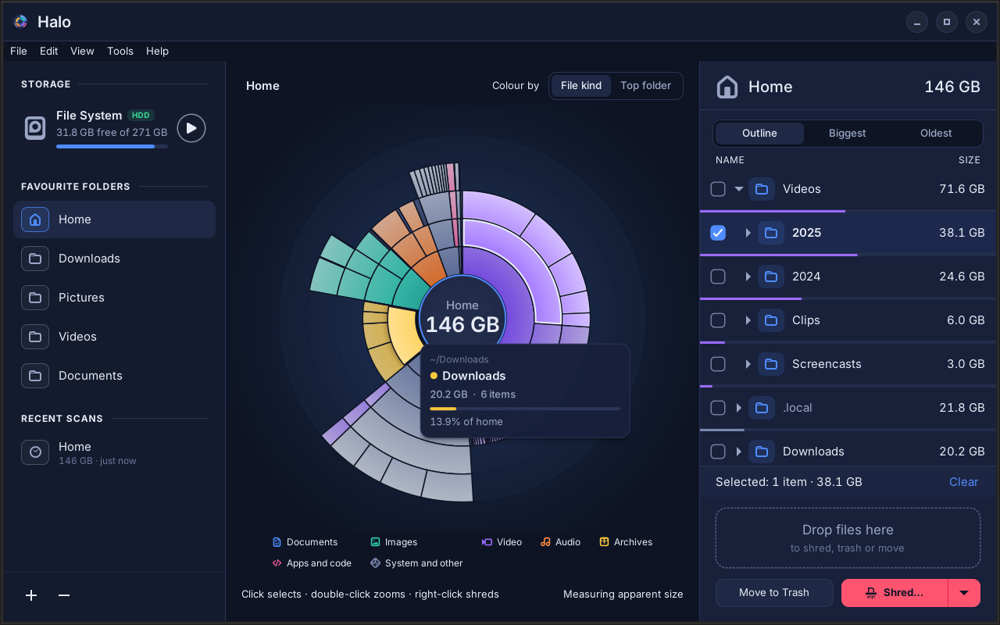

<div align="center">

# Halo

**See where your space went in seconds, then make sensitive files truly gone.**

[](https://github.com/RiyaKaushik10/halo/releases)
[](https://github.com/RiyaKaushik10/halo/releases/latest)
[](https://github.com/RiyaKaushik10/halo/releases/latest)
[](LICENSE)

**[⬇ Download Halo for Linux Mint (.deb)](https://github.com/RiyaKaushik10/halo/releases/latest)**

</div>

The download counter adds up every file downloaded from the [Releases page](https://github.com/RiyaKaushik10/halo/releases) — the `.deb` installer and the source tarball — across all versions, as reported by GitHub.

Halo is a native disk space analyzer and secure file shredder for Linux Mint. It shows what is filling your disk as an interactive, glowing sunburst, and lets you shred what you find — including the thumbnails, recent-file entries and Trash copies your desktop leaves behind. It ships as a single `.deb` that installs with a double-click.



## Features

- **Live sunburst** — the first chart appears within seconds and refines while a radar sweep passes over it. Up to five rings, biggest first, colour by file kind or by top folder, hover cards, smooth zoom.
- **Accurate numbers** — disk usage like `du` (or apparent size), hard links counted once, symlinks never followed, other filesystems shown separately.
- **Three lists** — Outline (the same tree as the chart), Biggest (top 200 files) and Oldest (big files unused for longest).
- **Select anywhere** — click, Ctrl+click, Shift+click and Ctrl+A in the chart or the list; one shared selection; right-click to act.
- **Secure shredder** — DoD 5220.22-M 3-pass method (zeros, ones, random) or a single random pass, with read-back verification, name scrubbing, and removal of thumbnails, recent-file entries and Trash copies.
- **Honest warnings** — Halo detects SSDs, copy-on-write filesystems, `data=journal`, Timeshift snapshots, sync folders and hard links, and explains the limits in plain language before you shred.
- **Safety rails** — protected paths, press-and-hold to confirm, dry-run mode, never follows symlinks.
- **Nemo integration** — "Analyze Disk Usage with Halo" and "Shred with Halo…" in the right-click menu.

## Privacy promise

Halo works entirely offline. It contains no networking code, collects no data, and needs no account or registration. A test in CI fails the build if networking imports ever appear. See [PRIVACY.md](PRIVACY.md).

## Install

Download `halo_1.0.1_all.deb` and `SHA256SUMS` from the GitHub Releases page, then either double-click the `.deb`, or:

```sh
sha256sum -c SHA256SUMS
sudo apt install ./halo_1.0.1_all.deb
```

Dependencies come from Linux Mint's own repositories: `python3`, `python3-gi`, `python3-gi-cairo`, `gir1.2-gtk-4.0`, `pkexec`.

Halo targets Linux Mint 22.x (Ubuntu 24.04 base) — Cinnamon, MATE and Xfce, and LMDE 7 — and keeps to GTK 4 APIs available there so the same package works on Mint 23.

## Build from source

```sh
sudo apt install debhelper devscripts lintian python3-gi python3-gi-cairo gir1.2-gtk-4.0
make test                  # pytest suite incl. the no-network check
make run                   # run from the checkout, in dry-run mode
dpkg-buildpackage -us -uc -b && lintian ../halo_*.deb
# or, without debhelper:
make deb                   # builds dist/halo_1.0.1_all.deb with dpkg-deb
# or install straight from the tarball:
sudo make install PREFIX=/usr/local
sudo make uninstall PREFIX=/usr/local
```

## Uninstalling

`sudo apt remove halo` removes the program. Like all Linux apps it leaves your per-user files (`~/.config/halo`, `~/.cache/halo`, `~/.local/state/halo`, and shred reports). Use **Tools › Clear Halo's Own Data…** before uninstalling if you want them gone.

## Updates

Halo never checks for updates. New versions appear on the GitHub Releases page; installing a newer `.deb` upgrades in place and keeps your settings.

## Developer

Riya K · [riyak1@proton.me](mailto:riyak1@proton.me) · MIT License
